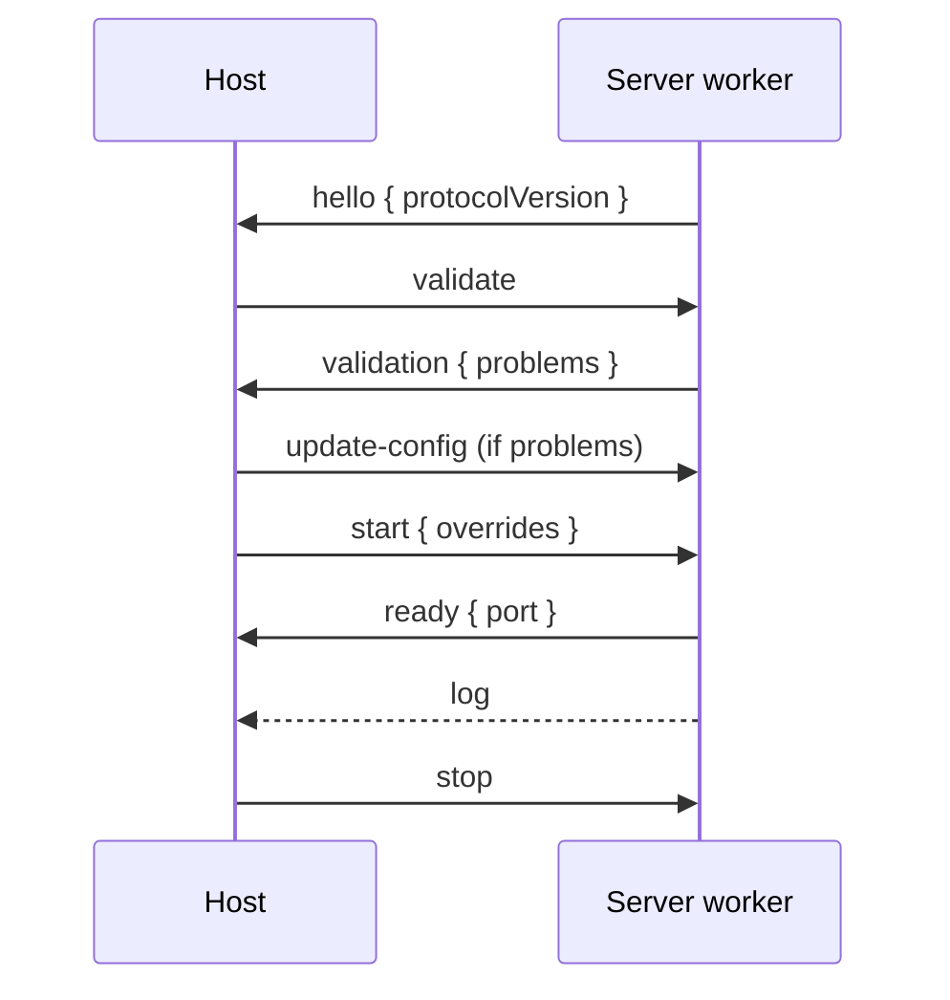

# Standalone agents server

The agents server (`apps/agents/server`) is built and shipped as a single file, `dist/apps/agents/server/main.js`. It runs in one of two modes.

## Modes

| Mode          | How                                           | Behavior                                                                                                                    |
| ------------- | --------------------------------------------- | --------------------------------------------------------------------------------------------------------------------------- |
| Standalone    | `node main.js`                                | Loads config, validates it, and starts on port 3000. Prints problems and exits with code 1 if IDL or the LLM is not set up. |
| Worker thread | `new Worker('main.js')` from Node or Electron | Waits for the host to send messages. Nothing heavy happens until `start`, so the host can check and fix the config first.   |

The server owns `desktop-agents.config.json`. Hosts read and change it through messages and do not share any code with the server. Their only contract is the protocol below and `protocolVersion`.

## Protocol

Messages are JSON strings sent with `postMessage` in both directions. The types are in [protocol.interface.ts](../../apps/agents/server/src/protocol.interface.ts). Hosts should keep their own copy.



Host to server. Every request except `stop` has a numeric `id` that is echoed in the response.

| Type            | Fields                        | Response                                                                    |
| --------------- | ----------------------------- | --------------------------------------------------------------------------- |
| `get-config`    |                               | `config`                                                                    |
| `update-config` | `config` (partial)            | `config`. Deep-merged, defaults filled, saved to disk. Arrays are replaced. |
| `validate`      |                               | `validation` with `problems`. No side effects.                              |
| `start`         | `overrides?` (`host`, `port`) | `ready` with `port`, or `error`. Validates again before starting.           |
| `stop`          |                               | None. The worker shuts down and exits.                                      |

Server to host.

| Type    | Fields                                | Notes                                                                         |
| ------- | ------------------------------------- | ----------------------------------------------------------------------------- |
| `hello` | `protocolVersion`                     | First message. Refuse to continue if the version differs.                     |
| `log`   | `level`, `log`, `content`             | Forwarded from the server's log manager and `console`.                        |
| `error` | `id?`, `code`, `message`, `problems?` | Codes: `INVALID_CONFIG`, `ALREADY_STARTED`, `START_FAILED`, `REQUEST_FAILED`. |

Problem codes are `IDL_NOT_FOUND`, `IDL_DIRECTORY_INVALID`, and `LLM_NOT_CONFIGURED`. IDL is found from `idl.directory` in the config (the folder containing the IDL executable). If that is empty the server searches for IDL automatically, and a non-empty value that is not valid is reported and never falls back to searching. Unknown message types are ignored, so older and newer hosts and servers can coexist.

After `start`, config changes need a new worker. If `start` fails (`START_FAILED`) the worker exits.

## Example

[launch-as-worker.example.cjs](../../apps/agents/server/src/examples/launch-as-worker.example.cjs) is a self-contained host that runs `hello`, `validate`, `start`, then `stop` on Ctrl+C.

```bash
nx build agents-server
node apps/agents/server/src/examples/launch-as-worker.example.cjs
```

Set `AGENTS_SERVER_FILE` to launch a different `main.js`.

## Electron

Use the same code from the main process, with these differences:

- Point at the unpacked `main.js` (outside `app.asar`) since workers cannot load files from inside the archive.
- Set `NODE_PATH` to `<resources>/app.asar.unpacked/node_modules` in the worker's `env`. Some dependencies are not bundled, and the worker does not resolve them the way the main process does. The example does this when `process.resourcesPath` is set.
- The worker's stdout is not surfaced, so use the `log` messages.
